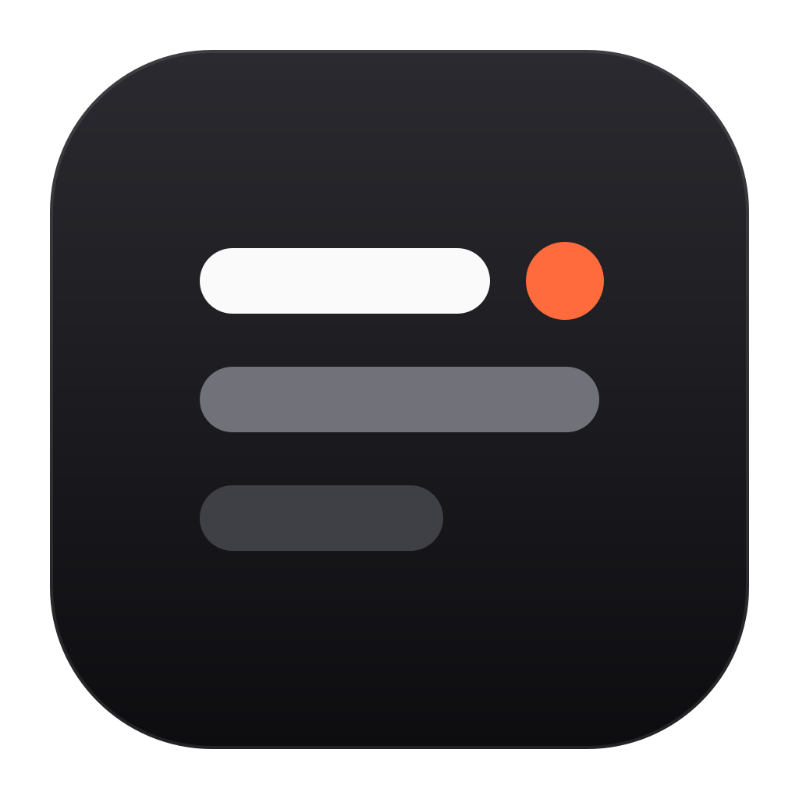
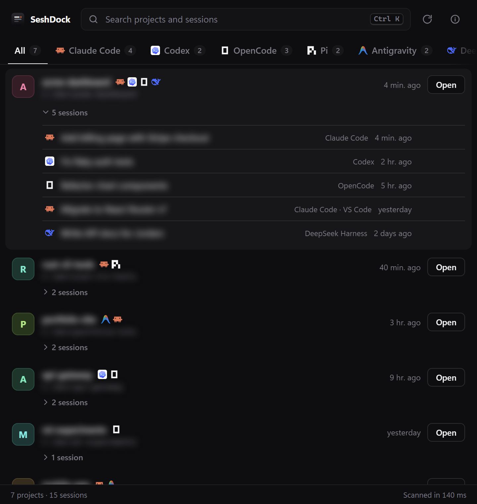

<p align="center">
  
</p>

<h1 align="center">SeshDock</h1>

<p align="center">
  Every AI coding session on your machine, in one place.<br>
  Find it. Resume it. Get back to work.
</p>

<p align="center">Built by <a href="https://www.founder.tn/seif_amara">Seif Amara</a></p>

<p align="center">
  &nbsp;
  &nbsp;
  &nbsp;
  &nbsp;
  &nbsp;
  &nbsp;
  &nbsp;
  
</p>

<p align="center">
  
</p>

---

## Why this exists

I built this tool while I was angry. I opened my laptop to work, launched Claude Code in the project folder, and couldn’t find my session. This has happened to me so many times, which made me even angrier, especially since I have the memory of a goldfish and never remember which folder the project is in or where the session is saved.

So I built this tool in a bit over an hour. I told Claude what I wanted and guided it step by step until it did what I needed.

It’s open source for anyone who runs into the same problem. Claude will write the rest of the docs.

---

## What it does

- **One list for every harness.** SeshDock scans Claude Code (CLI, VS Code extension and Desktop), Codex, OpenCode, Pi, Antigravity, DeepSeek Harness, DeepSeek TUI (Codewhale), OpenClaw and Hermes Agent at startup. It groups their sessions by project folder, so if you used three tools in the same repo, all three show up under that repo.
- **Sessions, newest first.** Expand any project to see all of its conversations with their titles and when you last touched them.
- **Resume in one click.** Choose **Open** to resume the latest session, or **Resume** on a specific one. SeshDock asks where to open it:
  - **Terminal**: opens the project folder and runs the right resume command, so you land back in that exact conversation.
  - **Claude Code in VS Code / Cursor**: opens the folder and resumes the session in the Claude Code extension panel (shown when the extension is installed).
  - **Editor**: opens the folder in an installed IDE (VS Code, Cursor, Windsurf, Zed, Antigravity).
  - **DeepSeek Harness**: brings up the DeepSeek Harness app, where the session is in the sidebar.
  - **Obsidian**: opens the folder as a vault, if it is one.
- **Search and filter.** Press `Ctrl K` (`⌘K` on macOS) to search names, paths, descriptions and session titles. Use the tabs to filter by harness.
- **Hover for context.** Each project shows its README tagline (or `package.json` / `Cargo.toml` description) when you hover it.
- **Small and fast.** Native Tauri app, a ~3 MB installer, scans in a fraction of a second.

## Install

Download the installer for your OS from the [Releases](../../releases) page:

| OS | File |
|---|---|
| Windows | `SeshDock_x.y.z_x64-setup.exe` or `.msi` |
| macOS | `SeshDock_x.y.z_aarch64.dmg` / `x64.dmg` |

### Build from source

Requirements: [Rust](https://rustup.rs), [Node.js](https://nodejs.org) 18+, and the [Tauri prerequisites](https://v2.tauri.app/start/prerequisites/) for your OS.

```sh
git clone <this repo>
cd seshdock
npm install
npm run dev      # run in development
npm run build    # installers → src-tauri/target/release/bundle/
```

macOS installers must be built on a Mac (or in CI on a `macos-latest` runner).

## How it works

SeshDock only **reads** the files each tool already keeps on disk. It never writes to them and never sends anything over the network.

| Harness | Where sessions live | Resume command SeshDock runs |
|---|---|---|
| Claude Code (CLI, VS Code, Desktop) | `~/.claude/projects/*/*.jsonl` (respects `CLAUDE_CONFIG_DIR`) | `claude --resume <id>` |
| Codex | `~/.codex/sessions/**/rollout-*.jsonl` + `session_index.jsonl` (respects `CODEX_HOME`) | `codex resume <id>` |
| OpenCode | `~/.local/share/opencode/opencode.db` (respects `XDG_DATA_HOME`) | `opencode --session <id>` |
| Pi | `~/.pi/agent/sessions/**/*.jsonl` | `pi --session <id>` |
| Antigravity | `~/.gemini/antigravity/conversations/*.db` + `annotations/*.pbtxt` | `agy --conversation <id>` |
| DeepSeek Harness (desktop app) | `~/.dsh/sessions/*/session-*/session.v4.jsonl.zstd` | opens the app (`dsh://open`); the app has no per-session link yet, so pick the session in its sidebar |
| DeepSeek TUI / Codewhale | `~/.codewhale/sessions/*.json`, legacy `~/.deepseek/sessions` (respects `CODEWHALE_HOME`, `DEEPSEEK_HOME`) | `codewhale --resume <id>` |
| OpenClaw | `~/.openclaw/agents/*/agent/openclaw-agent.sqlite` (respects `OPENCLAW_STATE_DIR`) | `openclaw tui --session <key>` |
| Hermes Agent | `state.db` in `HERMES_HOME` (`%LOCALAPPDATA%\hermes` on Windows, `~/.hermes` on macOS) | `hermes --resume <id>` |

Some details:
- Codex sub-agent threads, OpenCode and Hermes child or archived sessions are hidden.
- Older Antigravity conversations (`*.pb`) are encrypted and don't record their folder, so only the newer `*.db` ones are listed.
- Folders that no longer exist stay in the list, greyed out.
- The resume command is built in Rust from a validated session ID. The UI never passes a shell string.

**Terminals:** Windows Terminal (falls back to PowerShell) on Windows; Terminal.app or iTerm on macOS.

## Project layout

```
src-tauri/src/scan.rs   # the three scanners + grouping by folder
src-tauri/src/open.rs   # terminal / IDE detection and launching
ui/                     # plain HTML, CSS, JS (no framework, no bundler)
assets/logo.svg         # app logo, also the source for all app icons (npm run icon)
```

Tests: `cd src-tauri && cargo test`. To smoke-test against your own data, run `cargo test real_scan -- --ignored --nocapture`.

## Roadmap

- Linux support
- Older OpenCode versions (pre-SQLite JSON storage)
- Older OpenClaw versions (pre-SQLite `sessions.json` + JSONL)
- More harnesses (Gemini CLI, Qwen Code, Copilot CLI, Aider, …). PRs welcome. Each one is a single scanner function in `scan.rs`.

## License

[MIT](LICENSE)

Harness logos come from [LobeHub Icons](https://github.com/lobehub/lobe-icons) (MIT) and [Simple Icons](https://simpleicons.org) (CC0). They are trademarks of their respective owners and are used only to identify each tool. SeshDock is not affiliated with any of them.
